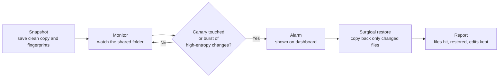

# SnapBack

**Ransomware detection and surgical recovery for shared storage.**

SnapBack watches a shared folder, raises an alarm when ransomware starts encrypting files, and restores **only the files the attacker damaged**, leaving the team's other work untouched.

> **Status:** Prototype built for a college hackathon (SkillSync 26'). It runs entirely on one machine against a simulated shared folder.
> It is not a production product.

## The problem

- Ransomware scrambles (encrypts) files so they cannot be opened, then demands payment.
- It spreads through shared drives and can rewrite hundreds of files in minutes, faster than people can react.
- Restoring a whole folder from an old backup also wipes out recent good work made after that backup.

**What we need:** notice the attack quickly, and undo only the damage.

## The idea

SnapBack combines four pieces:

| Piece                          | What it does                                                                                              |
| ------------------------------ | --------------------------------------------------------------------------------------------------------- |
| **Snapshot**             | Saves a copy of the folder at a known-good moment and records a fingerprint (SHA-256 hash) of every file. |
| **Detector**             | Watches for a burst of changed files whose new content looks encrypted (high entropy).                    |
| **Canary (decoy) files** | Fake, tempting files that nobody should ever touch. Any change raises an instant alarm.                   |
| **Surgical restore**     | Copies back only the files whose fingerprint no longer matches the snapshot.                              |

A live **dashboard** shows the attack, the alarm, and what was recovered.

## How it works



1. **Set up:** generate about 60 normal files and plant 3 to 5 canary files in different folders.
2. **Snapshot:** copy the folder and store a SHA-256 fingerprint for every file.
3. **Watch:** the detector checks which files changed and how random their new content looks.
4. **Attack:** the simulator rewrites files with random bytes, one at a time, so the damage is visible.
5. **Detect:** an alarm fires if a canary is touched, or if many files change quickly and look encrypted.
6. **Restore:** files whose fingerprint differs from the snapshot are copied back. Nothing else is touched.
7. **Report:** the dashboard shows detection time, files hit, files restored, and edits kept.

## What makes it different

- **Decoy detection:** alarms on the first touch of a canary file, before the real data is hit.
- **Surgical restore:** restores only the attacked files, so recent work on untouched files is kept.
- **Live dashboard:** the attack, the alarm, and the recovery are visible as they happen.
- **No special hardware:** works on any shared folder on one machine.

**Known limit:** if an attacker changed a file, its restored version is the snapshot copy, so any edit made to that same file during the attack is lost. Edits to files the attacker never touched are kept.

## Project structure

```
snapback/
├── README.md
├── requirements.txt
├── config.py                 # all thresholds and paths in one place
├── simulator/
│   ├── generate_files.py     # creates the normal fake files
│   ├── plant_canaries.py     # creates the decoy files
│   └── attack.py             # harmless ransomware simulator
├── core/
│   ├── entropy.py            # Shannon entropy
│   ├── snapshot.py           # snapshot and fingerprint store
│   ├── detector.py           # canary, burst and entropy checks
│   ├── canary.py             # watches decoy files
│   ├── restore.py            # surgical restore
│   └── events.py             # shared event log
├── server/
│   └── app.py                # FastAPI server and WebSocket
├── dashboard/
│   ├── index.html
│   ├── app.js
│   └── style.css
├── scripts/
│   └── run_demo.sh           # runs the whole demo with one command
├── tests/
│   ├── test_entropy.py
│   └── test_restore.py
└── storage/                  # generated at runtime, not committed
    ├── shared_drive/
    └── snapshots/
```

| Folder         | Rule                                                               |
| -------------- | ------------------------------------------------------------------ |
| `simulator/` | Creates fake data only. Never point it at a real folder.           |
| `core/`      | The logic. No UI code.                                             |
| `server/`    | Passes events from `core/` to the dashboard. No detection logic. |
| `dashboard/` | Display only. It reads events and never changes files.             |
| `storage/`   | Generated. Safe to delete and regenerate.                          |

## Configuration

All tunable values live in `config.py`. Nothing is hard-coded in the logic.

```python
SHARED_DIR = "storage/shared_drive"
SNAPSHOT_DIR = "storage/snapshots"
NUM_FILES = 60             # normal files to generate
NUM_CANARIES = 4           # decoy files
ATTACK_DELAY_SEC = 0.2     # time between encrypted files
CHANGE_WINDOW_SEC = 2.0    # look at changes in the last N seconds
CHANGE_THRESHOLD = 5       # changed files in the window that count as suspicious
ENTROPY_THRESHOLD = 7.5    # bits per byte; above this looks encrypted
CHECK_INTERVAL = 1.0       # detector runs once per second
```

## Getting started

```bash
git clone <repo-url>
cd snapback
python -m venv .venv
source .venv/bin/activate          # Windows: .venv\Scripts\activate
pip install -r requirements.txt
bash scripts/run_demo.sh
```

Then open the dashboard in your browser (the address is printed by the server) and press **Start**.

## Running the tests

```bash
pytest tests/
```

## Demo

 // to be added

*Add a screenshot or a short recording of a full run to `docs/` and update the link above.*

## Limits and next steps

- Runs on one machine against a simulated folder. It has not been tested on a real network share.
- Entropy alone can misfire on compressed files (ZIP, JPG, PNG). This is why the burst rule needs both a change burst and high entropy, and why canaries are a separate, more reliable signal.
- Thresholds in `config.py` are starting values and need tuning on real data.
- Possible next steps: real-time file system events on Windows and Linux, process attribution with `psutil`, and multi-user testing.
