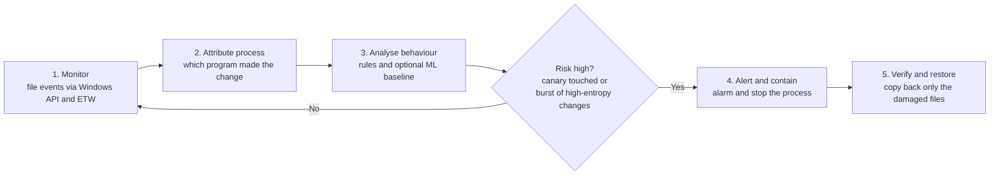

# SnapBack

**Ransomware detection and surgical recovery for shared storage.**

SnapBack watches a shared folder, raises an alarm when ransomware starts encrypting files, and restores **only the files the attacker damaged**, leaving the team's other work untouched.

> **Status:** Prototype built for a college hackathon (SkillSync 26'). It runs on one Windows machine against a simulated shared folder, with a Windows VM for isolated testing. It is not a production product.

---

## The problem

- Ransomware scrambles (encrypts) files so they cannot be opened, then demands payment.
- It spreads through shared drives and can rewrite hundreds of files in minutes, faster than people can react.
- Restoring a whole folder from an old backup also wipes out recent good work made after that backup.

**What we need:** notice the attack quickly, and undo only the damage.

## The idea

SnapBack combines four pieces:

| Piece                            | What it does                                                                                                                                             |
| -------------------------------- | -------------------------------------------------------------------------------------------------------------------------------------------------------- |
| **Protected backup vault** | Keeps versioned, access-controlled copies of the folder at known-good moments, with a SHA-256 fingerprint for every file.                                |
| **Detector**               | A rule-based risk engine that scores bursts of file changes, decoy hits and high-entropy content. Optional scikit-learn baselines learn normal activity. |
| **Canary (decoy) files**   | Fake, tempting files that nobody should ever touch. Any change raises an instant alarm.                                                                  |
| **Surgical restore**       | Copies back only the files whose fingerprint no longer matches the vault.                                                                                |

Process attribution (which program made the changes) comes from Windows API and ETW telemetry. A live **dashboard** shows the attack, the alarm, and what was recovered.

## How it works



1. **Set up:** generate about 60 normal files and plant 3 to 5 canary files in different folders.
2. **Snapshot:** copy the folder into the backup vault and store a SHA-256 fingerprint for every file.
3. **Monitor:** file events are collected through the Windows API and ETW.
4. **Attribute process:** each change is linked to the program that made it.
5. **Analyse behaviour:** the risk engine scores bursts, decoy hits and entropy. Optional scikit-learn baselines flag unusual behaviour.
6. **Alert and contain:** an alarm appears on the dashboard, and the suspicious activity is stopped.
7. **Verify and restore:** files whose fingerprint differs from the vault are copied back. Nothing else is touched.
8. **Report:** the dashboard shows detection time, files hit, files restored, and edits kept.

## What makes it different

- **Decoy detection:** alarms on the first touch of a canary file, before the real data is hit.
- **Surgical restore:** restores only the attacked files, so recent work on untouched files is kept.
- **Process attribution:** shows which program caused the damage, not just which files changed.
- **Live dashboard:** the attack, the alarm, and the recovery are visible as they happen.

**Known limit:** if an attacker changed a file, its restored version is the vault copy, so any edit made to that same file during the attack is lost. Edits to files the attacker never touched are kept.

## Tech stack

| Area                                 | Tools                   | Used for                                         |
| ------------------------------------ | ----------------------- | ------------------------------------------------ |
| **Core development**           | Python                  | Detection engine, orchestration and recovery     |
|                                      | Windows API + ETW       | File events and process telemetry                |
|                                      | FastAPI                 | Backend services and dashboard API               |
|                                      | React.js + Tailwind CSS | Interactive security dashboard                   |
| **Detection and intelligence** | scikit-learn            | Behaviour baselines and anomaly detection        |
|                                      | Rule-based risk engine  | Burst activity, decoys and file-change signals   |
|                                      | SHAP (optional)         | Explainable AI for model decisions               |
|                                      | Authenticode + SHA-256  | Executable signature checks and file integrity   |
| **Storage and validation**     | SQLite                  | File metadata, process records and event history |
|                                      | Protected backup vault  | Versioned, access-controlled recovery copies     |
|                                      | VirtualBox (Windows VM) | Isolated testing with synthetic files            |
|                                      | Git + GitHub            | Version control and team collaboration           |

## Project structure

The layout below is the planned structure. It may change as the code is written.

```
snapback/
├── README.md
├── requirements.txt
├── config.py                 # thresholds and paths in one place
├── simulator/
│   ├── generate_files.py     # creates the normal fake files
│   ├── plant_canaries.py     # creates the decoy files
│   └── attack.py             # harmless ransomware simulator
├── core/
│   ├── entropy.py            # Shannon entropy
│   ├── vault.py              # backup vault and SHA-256 fingerprints
│   ├── telemetry.py          # Windows API and ETW file and process events
│   ├── detector.py           # rule-based risk engine
│   ├── ml_baseline.py        # scikit-learn behaviour baseline (optional)
│   ├── canary.py             # watches decoy files
│   ├── restore.py            # surgical restore
│   ├── signatures.py         # Authenticode checks
│   └── events.py             # event log, stored in SQLite
├── server/
│   └── app.py                # FastAPI server
├── frontend/                 # React + Tailwind dashboard
├── scripts/
│   └── run_demo.ps1          # runs the whole demo with one command
├── tests/
└── storage/                  # generated at runtime, not committed
    ├── shared_drive/
    ├── vault/
    └── snapback.db
```

| Folder         | Rule                                                               |
| -------------- | ------------------------------------------------------------------ |
| `simulator/` | Creates fake data only. Never point it at a real folder.           |
| `core/`      | The logic. No UI code.                                             |
| `server/`    | Passes events from `core/` to the dashboard. No detection logic. |
| `frontend/`  | Display only. It reads events and never changes files.             |
| `storage/`   | Generated. Safe to delete and regenerate.                          |

## Configuration

All tunable values live in `config.py`. Nothing is hard-coded in the logic.

```python
SHARED_DIR = "storage/shared_drive"
VAULT_DIR = "storage/vault"
NUM_FILES = 60             # normal files to generate
NUM_CANARIES = 4           # decoy files
ATTACK_DELAY_SEC = 0.2     # time between encrypted files
CHANGE_WINDOW_SEC = 2.0    # look at changes in the last N seconds
CHANGE_THRESHOLD = 5       # changed files in the window that count as suspicious
ENTROPY_THRESHOLD = 7.5    # bits per byte; above this looks encrypted
CHECK_INTERVAL = 1.0       # detector runs once per second
```

## Getting started

Requires Windows 10 or 11 (Windows API and ETW are Windows-only). Use a Windows VM in VirtualBox for isolated testing.

```powershell
git clone <repo-url>
cd snapback
python -m venv .venv
.venv\Scripts\activate
pip install -r requirements.txt
cd frontend
npm install
npm run build
cd ..
powershell -ExecutionPolicy Bypass -File scripts\run_demo.ps1
```

Then open the dashboard in your browser (the address is printed by the server) and press **Start**.

## Running the tests

```powershell
pytest tests/
```

## Demo


*Add a screenshot or a short recording of a full run to `docs/` and update the link above.*

## Limits and next steps

- Runs on one Windows machine against a simulated folder. It has not been tested on a real network share.
- ETW and process attribution are Windows-only. Other platforms are out of scope for this prototype.
- Entropy alone can misfire on compressed files (ZIP, JPG, PNG). This is why the burst rule needs both a change burst and high entropy, and why canaries are a separate, more reliable signal.
- The scikit-learn baseline and SHAP explanations are optional. The rule-based engine is the main detector.
- Thresholds in `config.py` are starting values and need tuning on real data.
- Possible next steps: testing on a real network share, Authenticode checks on every changed executable, and multi-user testing.

## Team

| Role                              | Member | Area                                          |
| --------------------------------- | ------ | --------------------------------------------- |
| Simulator and canaries            |        | `simulator/`                                |
| Detection engine and ML           |        | `core/detector.py`, `core/ml_baseline.py` |
| Vault and restore                 |        | `core/vault.py`, `core/restore.py`        |
| Telemetry and process attribution |        | `core/telemetry.py`                         |
| Server and events                 |        | `server/app.py`, `core/events.py`         |
| Dashboard                         |        | `frontend/`                                 |
| Slides and pitch                  |        | Presentation                                  |

## License

Add a license before publishing (for example MIT).
